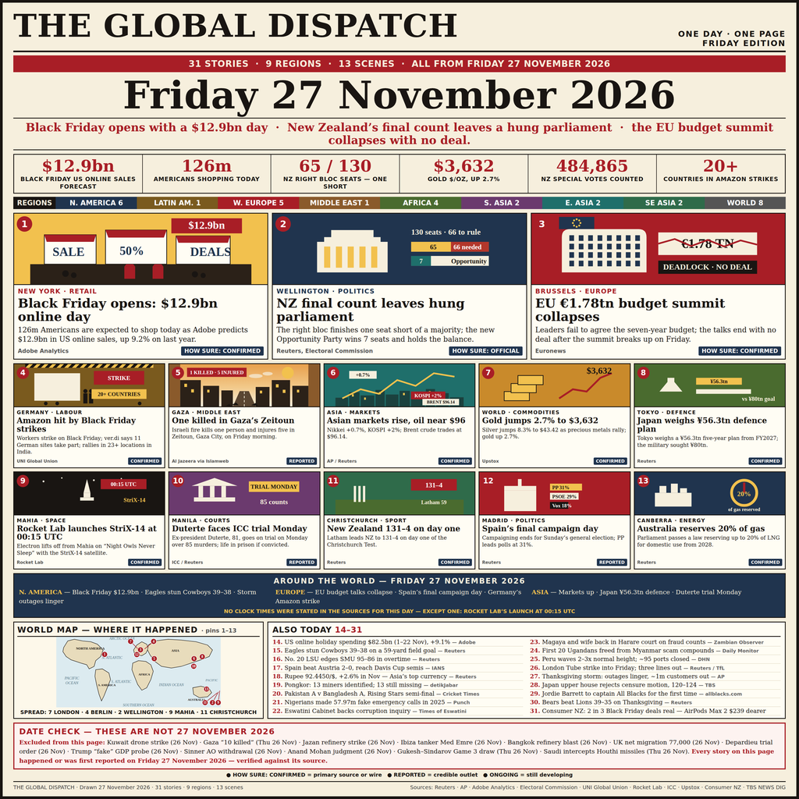

# THE GLOBAL DISPATCH — Friday 27 November 2026

One image that sums up the world's news of **Friday 27 November 2026** — a full
broadsheet page, drawn for the [make.fun](https://make.fun/bounty/news-image-20261127)
competition "Sum up 27 November's world news in one image".

## What is on the page

- **31 stories · 9 regions · 13 scenes** — every story happened or was first
  reported on Friday 27 November 2026, verified against its source.
- **Three leads:** Black Friday opens with a forecast $12.9bn US online day;
  New Zealand's final count leaves a hung parliament (65 of 130, one short
  of a majority); the EU budget summit collapses with no deal on €1.78tn.
- **Ten more drawn scenes:** the Amazon Black Friday strikes in 20+ countries,
  the Gaza Zeitoun strike, Asian markets, gold at $3,632, Japan's ¥56.3tn
  defence plan, Rocket Lab's StriX-14 launch at 00:15 UTC, the Duterte ICC
  trial, the Christchurch Test, Spain's final campaign day, and Australia's
  LNG reservation law.
- **A world map** with numbered pins 1–13, one per scene, and a date-check box
  naming the big stories that are **not** 27 November (Kuwait, Gaza "10
  killed", Jazan, Ibiza, Bangkok, UK migration, and more — all 26 November
  or earlier) so nothing wrong-dated is presented as the day's news.
- **A traceability ledger** (`traceability-ledger.json`) with one record per
  story: headline, source URL, event and publication dates, the facts used,
  verification, confidence, region and position on the page — plus the
  rejected list with reasons.

## How the image was made

The broadsheet was composed as HTML/CSS with every scene and the map drawn
fresh for this edition (dark-ink linework, one accent fill per scene),
rendered at 3000×3000 px in a headless browser and downscaled to the
1024×1024 px entry image. `main.py` copies the bundled `entry.png` to
`/output/entry.png` and validates it (PNG signature, chunk CRCs, dimensions
and size within the kit limits) before reporting its sha256. The program is
deterministic: two runs produce byte-identical output.

## Sources

Reuters, AP, Adobe Analytics, the New Zealand Electoral Commission,
UNI Global Union, Rocket Lab, the ICC, Upstox, Consumer NZ, TBS NEWS DIG,
and the outlets named on the page and in `traceability-ledger.json`.

## License

MIT — see [LICENSE](LICENSE).
